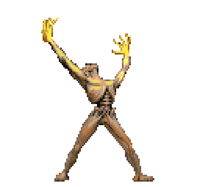
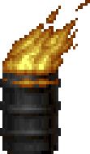
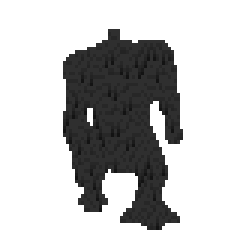
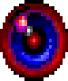
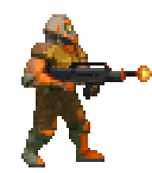
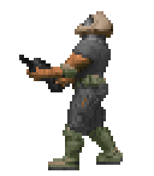
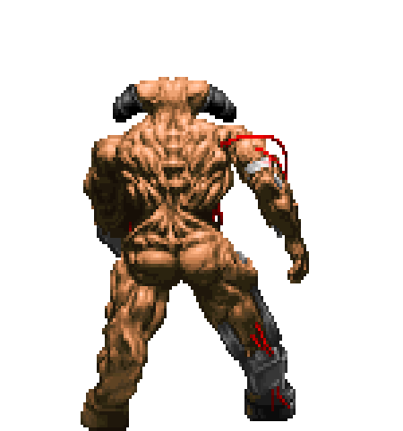

# dsprite2gif

**dsprite2gif** generates tic-accurate GIF animations of sprites read from Doom WADs and Doom's original state lookup table.

You can use this for whatever your heart desires. This was initially written for analysis video graphics many years ago, and now it's for everyone to use. If you're a content creator and you need some epic Doom graphics for your video, then this is your lucky day. You can also use it if you need a cool forum profile photo or an animated Discord emoji... the world is your oyster.

<p align="center">
  
  
</p>

## Requirements

- [Python](https://www.python.org/downloads/)
- [omgifol](https://pypi.org/project/omgifol/)
- [Pillow](https://pypi.org/project/pillow/)
- A Doom IWAD (e.g. `doom2.wad`)

### Windows

1. Install Python from [python.org](https://www.python.org/downloads/), or from a terminal:

   ```
   winget install Python.Python.3.13
   ```

2. Install packages:

   ```
   py -m pip install omgifol pillow
   ```

### Linux

I'm sure Linux users know how to Python.

<p align="center">
  
  
</p>

## Usage

```
py dsprite2gif.py doom2.wad
```

Just like in Doom, you can override content through PWADs. This is useful if you want to generate animations of custom enemies, or to apply a sprite fix WAD for correct offsets and other graphical quirks.

```
py dsprite2gif.py doom2.wad D2SPFX20.WAD
```

### Options

| Option | Description |
|---|---|
| `--infoc <path>` | Path to `info.c` (default: `info.c` in the current folder) |
| `--scale <number>` | Scale the GIFs up, e.g. `--scale 3` (default: 1.0) |
| `--no-aspect-ratio` | Keep square pixels instead of stretching them 1.2x vertically, like Doom (rightfully) does |
| `--all-fuzz` | Render every animation with the fuzzy partial invisibility effect |

<p align="center">
  
  
</p>

## To-do
- Add support for modified states through DEH and whatnot
- Add support for weapon sprite animations
- Add PLAYPAL support for WADs with custom palettes
- Fix states with refire checks (e.g. Chaingunners) as they don't loop seamlessly

<p align="center">
  
</p>

## License

dsprite2gif is licensed under the GNU GPLv2 or later. See [LICENSE](LICENSE).

The fuzz table and `info.c` are taken from Doom's source code by id Software. Both are licensed under the GNU GPLv2, see id Software's [Doom repository](https://github.com/id-Software/DOOM).

The README's animated sprites are © id Software.